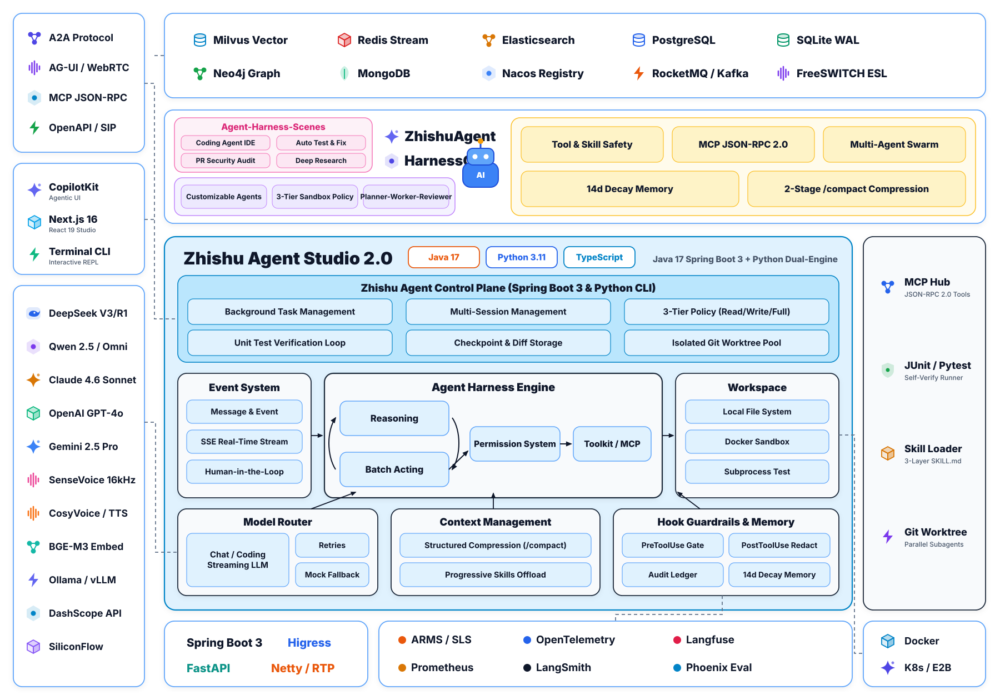

<div align="center">

# Zhishu Agent (知枢智能体) — Harness Patterns

### 从零构建生产级通用智能体与马具工程 (Harness)：Java 17 (Spring Boot 3) 全栈可视化工作台 + Python 零依赖模式库

[](https://www.zhihu.com/people/wang-guo-ha-53)
[](#-一java-17--spring-boot-3-全栈工作台wg-harness-studio)
[](#-二python-零依赖-8-大模式库与-wg-harness-cli)
[](#-核心-harness-模式清单)
[](./LICENSE)
[](https://github.com/wangguode/zhishu-agent/stargazers)

**模型决定上限，Harness（马具工程）决定下限。**
<br>提供 **Java 17 + Spring Boot 3 全栈 Web Studio 工作台** 与 **Python 零依赖 CLI/模式库** 双引擎实现，无需任何 API Key 即可一键跑通 Agent Loop、HITL 人工审批拦截、`/compact` 上下文压缩、MCP JSON-RPC 2.0 沙箱与单测自修复闭环；配置一行环境变量即可无缝切换 DeepSeek / 通义千问。

</div>

---

## 架构总览 (Editorial Architecture)

<p align="center">
  <picture>
    <source media="(prefers-color-scheme: dark)" srcset="./docs/assets/architecture-dark.svg">
    <source media="(prefers-color-scheme: light)" srcset="./docs/assets/architecture-light.svg">
    
  </picture>
</p>

---

## 为什么做这个项目？

Codex、Claude Code、AgentScope 等主流智能体系统的工程代码动辄数十万行，开发者在企业内部落地 Java / Python 智能体控制平面时，最常卡在五个核心工程问题上：

1. **Agent Loop 收敛与自验证**：如何让智能体在“推理 → 调工具改代码 → 跑单测 → 读报错自修复”闭环里稳定收敛，而不是改完不测直接交差？
2. **PreToolUse / PostToolUse 安全护栏与 HITL 审批**：`rm -rf /` 如何在毫秒内硬阻断？`kubectl rollout restart` 如何在 Java 后端挂起 `CompletableFuture` 等待人工点击放行，同时自动脱敏输出中的 `sk-*` 密钥？
3. **两级 `/compact` 上下文压缩**：长任务上下文快爆时，如何裁剪历史工具大输出并提炼结构化 Checkpoint 摘要（实测节省 85%+ Token）？
4. **Skills 三层渐进披露 & MCP 协议标准化**：挂载上百个企业技能为什么不会撑爆 Prompt？如何用标准 JSON-RPC 2.0 实现 MCP `initialize` / `tools/call`？
5. **跨会话时间衰减记忆**：如何结合“14 天半衰期 × 重要度 × 词重叠度”避免新会话失忆？

本仓库同时提供**开箱即用的 Java Spring Boot 3 全栈可视化平台**与**单文件零依赖 Python 对照实验室**，让你既能直接二次开发上线，也能在 30 秒内读懂底层机制。

---

## 一、Java 17 + Spring Boot 3 全栈跨平台工作台 (`Harness Agent`)

针对企业后端主流的 Java 技术栈与跨平台桌面研发场景，`java-harness-studio/`、`web-ui/` 与 `desktop-shell/` 模块基于 **Java 17 + Spring Boot 3.3.5 + Next.js/React + Electron (macOS / Windows)** 实现了开箱即用的 `Harness Agent` 全栈编码智能体工作台（包命名空间 `com.wangguoai.harness`）：

### 1. Harness Agent 主视图（ReAct 工具调用 + 单测自验证闭环 + 实时 Diff / 终端抽屉）
<p align="center">
  
</p>

### 2. 工具与 MCP 服务配置中心（支持一键开关、在线挂载 MCP Server 与 JSON-RPC 2.0 调试）
<p align="center">
  
</p>

### 3. Agent 技能 (`SKILL.md`) 渐进式管理中心（支持按需激活与在线编辑 Markdown）
<p align="center">
  
</p>

### 30 秒跨平台启动 & 桌面端打包（兼容 macOS `.dmg` / Windows `.exe`）

```bash
git clone https://github.com/wangguode/zhishu-agent.git
cd zhishu-agent

# 方式 A：macOS / Linux 一键启动 Web 工作台（自动编译并打开 http://127.0.0.1:8090）
./start-mac-linux.sh

# 方式 B：Windows 10/11 一键启动 Web 工作台（双击或 CMD/PowerShell 运行）
start-windows.bat

# 方式 C：启动或打包独立桌面客户端 (支持 macOS Apple Silicon/Intel .dmg 与 Windows .exe)
cd desktop-shell
npm install
npm start            # 直接拉起内嵌 Java 17 引擎的独立桌面窗口
npm run build:mac    # 打包 macOS 桌面安装包 (dist/*.dmg, dist/*.zip)
npm run build:win    # 打包 Windows 桌面安装包 (dist/*.exe NSIS & Portable)
```

启动后打开浏览器访问 **`http://localhost:8090`**，可直接交互体验四大工程面板：
- **Agent Loop 实时 SSE 轨迹与 HITL 人工审批流**：一键触发「单测报错驱动自修复闭环」、「危险命令 `rm -rf` 硬拦截」与「生产变更人工挂起审批（放行/拒绝）」。
- **Context Engineering (`/compact`) 实时压缩器**：对比原始长对话窗口与两级结构化 Checkpoint 摘要前后的 Token 节省率（>85%）。
- **MCP JSON-RPC 2.0 调试沙箱 & Skills 渐进披露**：在线发送标准 `initialize`、`tools/list`、`tools/call` 报文，查看三层按需加载的 `SKILL.md`。
- **Hook 实时审计账本 & 14 天半衰期衰减记忆检索**：实时记录每次工具调用的拦截/脱敏审计轨迹，支持动态写入与混合检索跨会话记忆。

> **接入真实大模型（DeepSeek / 通义千问 / OpenAI 兼容接口）**：
> ```bash
> export RUN_MODE=cloud
> export LLM_BASE_URL=https://api.deepseek.com/v1
> export LLM_API_KEY=sk-your-key
> export LLM_MODEL=deepseek-chat
> mvn spring-boot:run
> ```

---

## 二、Python 零依赖 8 大模式库与 `wg-harness` CLI

每个核心模式浓缩为一个独立、无第三方依赖的 Python 标准库脚本，既可单文件直接运行，也可通过 `wg-harness` CLI 挂载到 Claude Code / Cursor 中作为真实 MCP Server 使用：

| # | 模式 | 对应 Java 核心类 | 对应 Python 实验室 | 快速运行 |
| :-: | :--- | :--- | :--- | :--- |
| 01 | **Agent Loop 与分级策略** | `kernel/AgentLoopEngine.java` | [01_agent_loop](./labs/01_agent_loop/agent_loop.py) | `python3 labs/01_agent_loop/agent_loop.py` |
| 02 | **两级 `/compact` 上下文压缩** | `context/ContextCompactorService.java` | [02_context_compaction](./labs/02_context_compaction/compaction.py) | `python3 labs/02_context_compaction/compaction.py` |
| 03 | **Skills 三层渐进式披露** | `mcp/McpToolRegistryService.java` | [03_skills_progressive_disclosure](./labs/03_skills_progressive_disclosure/skills_loader.py) | `python3 labs/03_skills_progressive_disclosure/skills_loader.py` |
| 04 | **子智能体并行编排** | `kernel/AgentLoopEngine.java` | [04_subagent_orchestration](./labs/04_subagent_orchestration/subagents.py) | `python3 labs/04_subagent_orchestration/subagents.py` |
| 05 | **Hooks 护栏与密钥脱敏** | `guard/HookGuardrailService.java` | [05_hooks_guardrails](./labs/05_hooks_guardrails/hooks.py) | `python3 labs/05_hooks_guardrails/hooks.py` |
| 06 | **跨会话时间衰减记忆** | `memory/DecayMemoryStore.java` | [06_agent_memory](./labs/06_agent_memory/memory.py) | `python3 labs/06_agent_memory/memory.py` |
| 07 | **MCP Server (JSON-RPC 2.0)** | `mcp/McpToolRegistryService.java` | [07_mcp_server_stdio](./labs/07_mcp_server_stdio/mcp_stdio.py) | `python3 labs/07_mcp_server_stdio/mcp_stdio.py` |
| 08 | **单测驱动自我验证闭环** | `kernel/AgentLoopEngine.java` | [08_self_verification_loop](./labs/08_self_verification_loop/verify_loop.py) | `python3 labs/08_self_verification_loop/verify_loop.py` |

```bash
# 安装 Python CLI 工具箱
pip install -e .
wg-harness list
wg-harness run all
wg-harness mcp-stdio   # 标准 stdio 模式，可直接配置进 Claude Code / Cursor 的 mcpServers
```

---

## 目录结构

```text
zhishu-agent/
├── java-harness-studio/                            # Java 17 + Spring Boot 3.3 全栈可视化工作台
│   ├── pom.xml
│   └── src/main/
│       ├── java/com/wangguoai/harness/
│       │   ├── HarnessStudioApplication.java       # Spring Boot 启动入口 (默认 8090 端口)
│       │   ├── api/HarnessStudioController.java    # REST + SSE 流式事件控制器
│       │   ├── kernel/AgentLoopEngine.java         # Agent Loop、单测自修复与 HITL 审批状态机
│       │   ├── guard/HookGuardrailService.java     # PreToolUse 三档拦截 + PostToolUse 密钥脱敏
│       │   ├── context/ContextCompactorService.java# 两级 /compact 上下文裁剪与 Checkpoint 提炼
│       │   ├── mcp/McpToolRegistryService.java     # 标准 JSON-RPC 2.0 MCP Server & Skills 注册表
│       │   └── memory/DecayMemoryStore.java        # 14 天半衰期衰减记忆存储与检索
│       └── resources/static/                       # 全新 Editorial Tech 双色自适应前端工作台
├── labs/01_agent_loop ~ 08_self_verification_loop/ # Python 零依赖 8 大核心模式对照实现
├── wg_harness_cli.py & pyproject.toml              # `wg-harness` 命令行与 stdio MCP 入口
└── docs/assets/                                    # 亮/暗双色矢量架构图与控制台预览图
```

---

## 配套深度长文（知乎 @王果ai）

| 主题 | 文章 |
| :--- | :--- |
| Harness 总论 | [Agent(特别篇六)：Harness Engineering 和 Loop Engineering —— 一部 Agent 工程的血泪史](https://zhuanlan.zhihu.com/p/2051682264325546663) |
| Loop 收敛 | [Agent(特别篇七)：Graph Engineering 刷屏了，但先问一个问题：你的 Agent Loop 收敛过吗？](https://zhuanlan.zhihu.com/p/2064476217709949350) |
| 编码智能体源码 | [Agent(特别篇四)：Claude Code 源码泄露深度解析：51.2 万行 TypeScript 撕开的 Agent 工程真相](https://zhuanlan.zhihu.com/p/2022688581404168978) |
| Agent OS 内核 | [Agent篇(28)：Harness Engineering——Agent OS 的真正内核：任务循环、状态、沙箱与自我验证](https://zhuanlan.zhihu.com/p/2069920445848204198) |
| Agent Skills | [Agent篇(29)：Agent Skills——把企业能力封装成可安装的软件包](https://zhuanlan.zhihu.com/p/2072106765785867888) |
| 工具调用演进 | [从“能聊”到“能干”：深度拆解 Function Calling、MCP 与 Anthropic Skills](https://zhuanlan.zhihu.com/p/78345307884) |

姐妹仓库：
- [voice-agent-rtp-gateway](https://github.com/wangguode/voice-agent-rtp-gateway) —— 企业级中文实时语音智能体网关（Java Spring Boot 3 全栈语音控制台 + Python Pipecat 管道 + FreeSWITCH 60ms 毫秒级打断）
- [AI-Agent-and-Voice-Engineering](https://github.com/wangguode/AI-Agent-and-Voice-Engineering) —— 知乎 @王果ai 100+ 篇体系化长文全景索引与配套代码实验室

---

## 致谢与架构参考

本仓库源码由作者在 `com.wangguoai.harness` 与 `labs/` 下全新编写，架构与控制面设计借鉴了以下优秀开源项目的工程理念：
- Java 智能体与 Harness 架构参考：[agentscope-ai/agentscope-java](https://github.com/agentscope-ai/agentscope-java)（Apache-2.0）· [alibaba/spring-ai-alibaba](https://github.com/alibaba/spring-ai-alibaba)（Apache-2.0）
- 编码智能体控制循环、Skills 与记忆机制参考：[openai/codex](https://github.com/openai/codex) · [anthropics/skills](https://github.com/anthropics/skills) · [modelcontextprotocol](https://github.com/modelcontextprotocol)

## License

[MIT](./LICENSE) © 2026 王果（wangguode）
